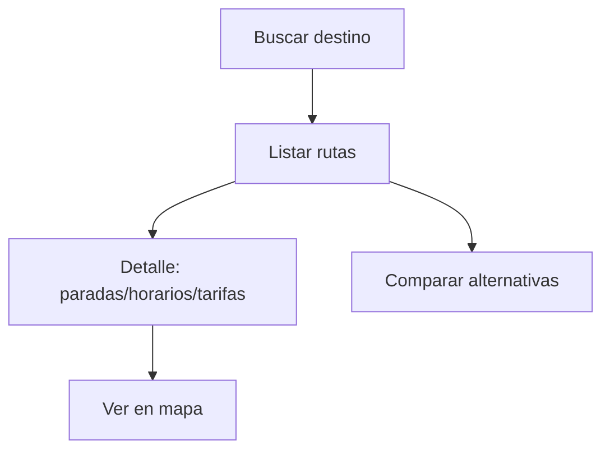
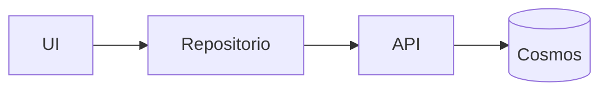
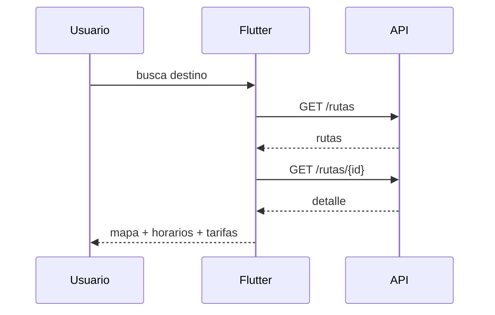

# Diagramas — Consulta de transporte, mapa y alternativas

> Spec: `spec.md` · Plan: `plan.md`. Diagramas Mermaid; no representan recursos desplegados.

## 1. Flujo funcional

## 2. Relación entre componentes

## 3. Flujo de datos / secuencia

## 4. Notas

Los endpoints de dominio son propuestos; solo login/logout existen.
