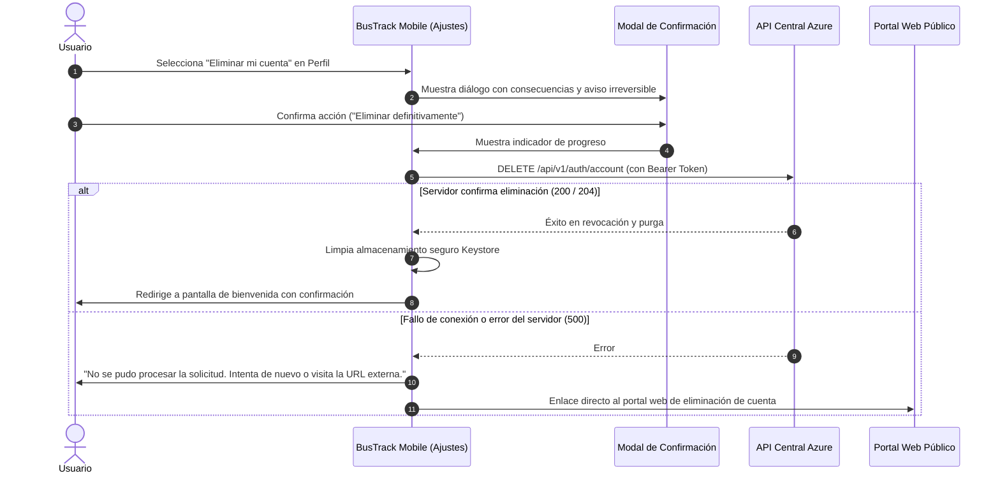
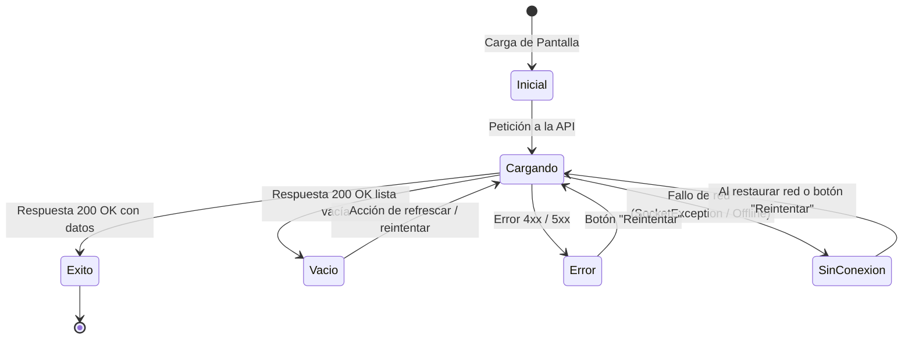

# BusTrack Mobile — Configuración Global de Diseño, Seguridad y Preparación para Google Play Store

> **Documento Normativo y Guía Maestra de Ingeniería Mobile**  
> **Ecosistema:** BusTrack Sistema Metropolitano de Transporte  
> **Tecnología Objetivo:** Flutter & Dart (Arquitectura Feature-First)  
> **Plataforma Principal:** Android (targetSdkVersion: Android 16 / API 36)  
> **Versión:** 2.0.0 — Fecha: 2026-11-10  
> **Estado:** Aprobado para implementación global en todas las pantallas.

---

## 1. Identidad Visual Global y Sistema de Tokens

BusTrack mantiene una identidad visual sólida, moderna y de alto contraste, diseñada para facilitar la legibilidad en condiciones de movilidad urbana (luz solar directa, movimiento en paradas y autobuses).

### 1.1 Paleta Cromática Oficial

| Token Semántico | Código HEX | Rol y Aplicación Visual | Contraste sobre Blanco | Ratio WCAG 2.1 |
|---|---|---|---|---|
| **Primary** | `#CF1818` | Rojo BusTrack: Botones primarios (CTA), bordes de foco activo, logos, pines destacados y elementos clave. | **4.85:1** | AA Texto / AAA Componentes |
| **Primary Dark** | `#9B1010` | Estados *pressed/hover* de botones principales, acentos de encabezado y badges de alerta. | **7.1:1** | AAA (Máxima legibilidad) |
| **Secondary** | `#906D6D` | Tonos complementarios: subtítulos descriptivos, iconos pasivos, bordes suaves y textos de ayuda. | **4.52:1** | AA (Texto regular) |
| **Tertiary / Soft** | `#FFD0C5` | Fondos de tarjetas informativas, contenedores de alertas amigables, acentos de rutas activas. | Decorativo | Base suave de lectura |
| **Neutral Dark** | `#333333` | Títulos principales, valores de formularios, etiquetas activas y textos de alto contraste. | **12.6:1** | AAA (Óptimo) |
| **Surface White** | `#FFFFFF` | Fondo principal de pantallas, tarjetas elevadas y contenedores limpios. | Base lumínica | 1:1 |
| **Input Background** | `#F8FAFC` | Fondo de campos de entrada (Slate 50) para garantizar percepción de área interactuable. | Fondo neutro | Área táctil |
| **Input Border** | `#E2E8F0` | Borde pasivo en reposo de inputs y separadores visuales (Slate 200). | Delimitador | 1.5:1 |
| **Success Alert** | `#059669` | Indicador de unidades en servicio, confirmaciones de guardado y badges positivos. | **4.6:1** | AA |
| **Warning Alert** | `#D97706` | Avisos de desvíos, demoras de ruta y consentimientos opcionales. | **4.5:1** | AA |
| **Error Alert** | `#DC2626` | Errores de validación, fallos de red y alertas críticas de seguridad. | **4.9:1** | AA |
| **Offline Banner** | `#475569` | Estado sin conexión a internet y modo consulta local fuera de línea. | **7.5:1** | AAA |

---

### 1.2 Jerarquía Tipográfica (`Plus Jakarta Sans`)

Se establece la tipografía geométrica legible **Plus Jakarta Sans** como estándar en todas las pantallas. Todos los tamaños se definen en unidades escalables (`sp`) respetando las preferencias de accesibilidad del sistema operativo.

```
Display Large (28sp / Bold 700 / -0.5px letter spacing)
  ├── Title Large (24sp / ExtraBold 800 / -0.5px) ──> Encabezados de pantalla
  │     ├── Title Medium (18sp / Bold 700) ─────────> Títulos de sección y tarjetas
  │     └── Title Small (16sp / SemiBold 600) ──────> Títulos de diálogos y listas
  ├── Body Medium (14sp / Medium 500 / 1.4 line height) ──> Textos de lectura y campos
  ├── Body Small (12sp / Regular 400 / 1.3 line height) ──> Microcopy, placeholders y notas
  ├── Button Label (14sp / Bold 700 / 0.2px) ─────────────> Botones interactivos
  └── Caption / Badge (11sp / ExtraBold 800 / 0.8px) ─────> Badges, pasos ("PASO 3 DE 3")
```

---

### 1.3 Espaciado, Márgenes, Radios y Elevaciones

- **Unidad Base de Retícula:** Cuadrícula de 8 puntos (`8dp`).
- **Márgenes de Pantalla:**
  - Teléfonos estándar: `horizontal: 24.0dp`, `vertical: 16.0dp`.
  - Teléfonos compactos (<360dp de ancho): `horizontal: 16.0dp`, `vertical: 12.0dp`.
- **Relleno Interno (Padding):**
  - Botones principales: `vertical: 16.0dp`, `horizontal: 24.0dp`.
  - Campos de formulario: `horizontal: 16.0dp`, `vertical: 14.0dp`.
  - Tarjetas: `all: 16.0dp`.
- **Radios de Borde (BorderRadius):**
  - Botones, tarjetas y modales: `BorderRadius.circular(16.0)`.
  - Inputs de formulario y selectores: `BorderRadius.circular(12.0)`.
  - Casillas OTP: `BorderRadius.circular(16.0)`.
  - Badges, chips y píldoras: `BorderRadius.circular(999.0)`.
- **Sombras y Elevaciones (Discretas):**
  - Elevación 1 (Tarjetas en reposo): `BoxShadow(color: Color(0x0D000000), blurRadius: 8, offset: Offset(0, 2))`.
  - Elevación 2 (Botones primarios con foco): `BoxShadow(color: Color(0x33CF1818), blurRadius: 16, offset: Offset(0, 6))`.
  - Prohibido el uso de sombras duras, resplandores artificiales o gradientes no aprobados.

---

### 1.4 Catálogo de Componentes Globales Reutilizables

Para garantizar coherencia en todo el ciclo de vida de la aplicación, se establecen los siguientes componentes maestros en `lib/core/widgets/`:

```
lib/core/widgets/
├── app_buttons.dart         # Botón Primario (#CF1818), Secundario (Outline) y Terciario (Soft)
├── custom_text_field.dart   # Input accesible con estados: reposo, foco, error y deshabilitado
├── app_dropdown.dart        # Selector desplegable accesible con modal inferior
├── app_controls.dart        # Checkboxes y Switches con área táctil >= 48dp
├── app_card.dart            # Tarjeta de contenido con borde Slate 200 y radio 16dp
├── app_dialogs.dart         # Diálogos de confirmación, advertencia y eliminación de cuenta
├── app_states.dart          # Vistas de Carga, Error, Sin Conexión (Offline) y Vacío (Empty State)
├── live_status_card.dart    # Tarjeta de estado de servicio metropolitano en tiempo real
└── otp_field.dart           # Casillas de 4 dígitos para validación multifactor/recuperación
```

#### Estados Visuales Estandarizados:
1. **Botones (`Primary`, `Secondary`, `Tertiary`):**
   - *Habilitado:* Fondo oficial y texto blanco/neutro.
   - *Presionado:* Oscurecimiento sutil (`#9B1010` en primario).
   - *Cargando (`isLoading = true`):* Deshabilita pulsaciones dobles y muestra spinner circular de contraste (`CircularProgressIndicator(strokeWidth: 2)`).
   - *Deshabilitado:* Fondo `#E2E8F0` y texto `#94A3B8`.
2. **Campos de Entrada (`CustomTextField`):**
   - *Reposo:* Borde `#E2E8F0`, fondo `#F8FAFC`.
   - *Foco:* Borde `#CF1818` (grosor 2.0dp), fondo blanco.
   - *Error:* Borde `#DC2626` (grosor 1.5dp) con icono de advertencia y mensaje explicativo inferior.
   - *Deshabilitado:* Opacidad 0.6 y cursor deshabilitado.

---

## 2. Diseño Adaptable (Responsive) y Accesibilidad (A11y)

### 2.1 Adaptabilidad a Dispositivos Android

- **Soporte de Pantallas:** Teléfonos desde 320dp de ancho (compactos) hasta pantallas grandes y plegables.
- **Orientación:** Orientación vertical (`portraitUp`) como estándar operativo principal en transporte público. Bloqueo de rotación accidental mediante `SystemChrome.setPreferredOrientations`.
- **Protección contra Teclado Virtual:**
  - Uso obligatorio de `Scaffold(resizeToAvoidBottomInset: true)` combinado con `SingleChildScrollView(keyboardDismissBehavior: ScrollViewKeyboardDismissBehavior.onDrag)`.
  - Asegurar que ningún botón de acción (CTA) quede tapado u oculto por el teclado de Android.
- **Scroll Seguro:** Toda pantalla con contenido dinámico o formularios cuenta con desplazamiento vertical nativo con física `BouncingScrollPhysics` o `ClampingScrollPhysics`.

### 2.2 Accesibilidad (WCAG 2.1 Nivel AA)

1. **Áreas Táctiles Mínimas:**
   - Todo elemento interactivo (botones, checkboxes, iconos de acción, enlaces) debe contar con una caja de toque de mínimo **48 x 48 dp**, conforme a los lineamientos de Google Material y Android Accessibility Scanner.
2. **Contraste Cromático:**
   - Texto principal `#333333` sobre `#FFFFFF`: ratio **12.6:1** (Cumple AAA).
   - Primario `#CF1818` sobre `#FFFFFF`: ratio **4.85:1** (Cumple AA texto y AAA componentes).
3. **Escalabilidad de Texto:**
   - La aplicación no fija alturas de contenedor en píxeles fijos que truncen el texto cuando el usuario incrementa el tamaño de fuente del sistema (soporta factores de escala de texto hasta 1.5x mediante `MediaQuery.textScaleFactorOf`).
4. **Semántica para Lectores de Pantalla (TalkBack):**
   - Todos los iconos decorativos usan `excludeFromSemantics: true`.
   - Los botones interactivos y campos de formulario cuentan con `Semantics(label: ..., hint: ...)` claros en español.
5. **No Dependencia Exclusiva del Color:**
   - Los estados de error, advertencia o éxito van acompañados de iconografía explícita y texto descriptivo, nunca únicamente de cambios de color.

---

## 3. Seguridad Integral de la Aplicación

BusTrack implementa el estándar de seguridad bancaria/empresarial para aplicaciones móviles siguiendo los lineamientos de **OWASP Mobile Application Security (MASVS L2)**.

```mermaid
flowchart TD
    subgraph Cliente Mobile ["BusTrack Mobile (Flutter/Dart)"]
        UI["Capa de Presentación (UI)"]
        VAL["Validación Local de Formularios"]
        SEC_STORE["Android Keystore + EncryptedSharedPreferences"]
        INTERCEPTOR["Cliente HTTP Seguro (Timeouts + Auth Bearer + CorrelationId)"]
    end

    subgraph Red ["Canal Seguro"]
        TLS["HTTPS / TLS 1.3 Cifrado Obligatorio"]
    end

    subgraph Backend ["Plataforma Azure BusTrack"]
        API["API Central REST (/api/v1)"]
        AUTH_SRV["Servicio de Autenticación (Emisión JWT)"]
        COSMOS[("Cosmos DB NoSQL")]
    end

    UI --> VAL
    VAL --> INTERCEPTOR
    INTERCEPTOR <-->|Token JWT + Expiración| SEC_STORE
    INTERCEPTOR === TLS === API
    API --> AUTH_SRV
    API --> COSMOS
    Cliente Mobile -.->|Prohibido Acceso Directo| COSMOS
```

### 3.1 Autenticación y Manejo de Sesión
- **Consumo REST Exclusivo:** La app se comunica únicamente con la API central mediante HTTPS. Prohibido cualquier acceso directo a bases de datos o servicios internos de ML/Cosmos DB.
- **Tokens JWT:** Validación server-driven. El token emitido por `POST /api/v1/auth/login` contiene tiempo de expiración estricto.
- **Prevención de Fugas:**
  - Prohibido imprimir tokens, contraseñas o PII en logs (`debugPrint`, `print` o `Log.d`).
  - Los logs de depuración solo registran códigos de estado HTTP y `CorrelationId` sanitizados.
- **Cierre de Sesión Local-First:** El logout (`POST /api/v1/auth/logout`) limpia de inmediato las credenciales en el almacenamiento seguro local antes de finalizar la llamada de red, evitando sesiones huérfanas en fallos de conectividad.

### 3.2 Almacenamiento Seguro
- **Cero Texto Plano:** Prohibido guardar contraseñas o tokens en `SharedPreferences` estándar.
- **Keystore / EncryptedSharedPreferences:** Utilización del Android Keystore con cifrado de hardware (AES-256 GCM) para persistir:
  1. `auth_token`: Token JWT de sesión activa.
  2. `token_expiration`: Marca de tiempo Unix de expiración.
  3. `user_profile`: Datos mínimos no sensibles (nombre y correo).
- **Cero Secretos en el Código:** Ninguna API key, secreto o contraseña debe estar hardcodeada en el repositorio Dart/Flutter ni en Gradle.

### 3.3 Comunicación Segura de Red
- **HTTPS Obligatorio:** En producción no se permite tráfico en texto plano (`cleartextTrafficPermitted: false` en `network_security_config.xml`).
- **Timeouts Estrictos:** 10 segundos para conexión y 15 segundos para lectura de respuestas.
- **Mapeo Tipado de Errores:** Se mapean códigos de error HTTP a mensajes amigables para el usuario (401 = Sesión expirada, 403 = Sin permisos, 429 = Demasiadas solicitudes, 500 = Servicio temporalmente no disponible). Jamás se muestran excepciones de servidor, trazas (`stacktraces`) o errores internos de Azure.

### 3.4 Protección de Formularios
- **Validación Local Previa:** Correo electrónico en formato RFC 5322 y longitud mínima de contraseña (8 caracteres con números y letras).
- **Protección contra Doble Envío:** Deshabilitación inmediata del botón tras el primer toque mientras exista una llamada asíncrona activa.
- **Visibilidad Controlada de Contraseñas:** Por defecto la contraseña se muestra oculta con botón accesible para conmutar visibilidad.

---

## 4. Privacidad, Protección de Datos y Eliminación de Cuenta

BusTrack aplica el principio de **Minimización de Datos** (GDPR / LFPDPPP): solo se solicitan los datos indispensables para consultar y planificar viajes metropolitanos.

### 4.1 Transparencia y Aviso de Privacidad
- Acceso directo al **Aviso de Privacidad** y **Términos del Servicio** desde el registro, el login y la sección de configuración de perfil.
- El aviso detalla con exactitud qué datos se recogen (correo y nombre), su finalidad exclusiva (autenticación y favoritos), el tiempo de retención y el canal de atención al titular (`soporte@bustrack.com`).
- Concordancia total con el formulario de **Data Safety** de Google Play Console.

### 4.2 Proceso Completo de Eliminación de Cuenta (Requisito Google Play)

Conforme a la política de Google Play sobre eliminación de cuentas iniciadas por el usuario:



**Reglas de Eliminación:**
1. **Flujo dentro de la App:** Ajustes > Privacidad > «Eliminar mi cuenta».
2. **Explicación clara:** Se informa que se borrarán los favoritos, historial de consultas y datos de cuenta sin posibilidad de recuperación.
3. **Confirmación explícita:** Requiere confirmación secundaria (botón destructivo en rojo `#CF1818`).
4. **No simulación:** Si el servidor no responde con 200/204, no se simula éxito; se informa del error y se ofrece el enlace web.
5. **Portal Web Externo:** Se declara en Google Play Console la URL pública oficial (ej. `https://bustrack.com/privacidad/eliminar-cuenta`) donde cualquier usuario puede solicitar la baja sin necesidad de tener la app instalada.

---

## 5. Matriz de Permisos de Android

BusTrack es una aplicación orientada a la **orientación y consulta** de rutas, no al espionaje ni al rastreo intrusivo.

| Permiso Android | Nivel | Justificación y Regla Operativa en BusTrack | Momento de Solicitud |
|---|---|---|---|
| `ACCESS_FINE_LOCATION` / `ACCESS_COARSE_LOCATION` | Peligroso (En tiempo de ejecución) | **Opcional y bajo demanda:** Exclusivamente para centrar el mapa en la posición actual del usuario y calcular paradas cercanas. **Prohibido el rastreo en segundo plano (`ACCESS_BACKGROUND_LOCATION`)**. La app funciona 100% si el usuario rechaza este permiso. | Únicamente al pulsar el botón «Mi ubicación» en el mapa. |
| `HIGH_SAMPLING_RATE_SENSORS` / Sensores de movimiento | Normal | **Módulo ML (Acelerómetro):** Para recopilar datos cinemáticos que alimentan el modelo de detección de paradas. **Exige consentimiento explícito previo y revocable en Ajustes**. | Pantalla dedicada de consentimiento de sensores. |
| `INTERNET` | Normal | Consulta de datos a la API central REST. | Concedido en instalación. |
| `ACCESS_NETWORK_STATE` | Normal | Detección de conectividad para activar el modo Offline. | Concedido en instalación. |

> [!CAUTION]
> **Permisos Prohibidos en BusTrack Mobile:**
> - ❌ `CAMERA`, `RECORD_AUDIO`: No se requiere captura multimedia.
> - ❌ `READ_CONTACTS`, `READ_CALL_LOG`: No se accede a la libreta ni llamadas.
> - ❌ `READ_EXTERNAL_STORAGE` / `MANAGE_EXTERNAL_STORAGE`: No se almacenan archivos fuera del sandbox privado.
> - ❌ `ACCESS_BACKGROUND_LOCATION`: Violación grave de la constitución de BusTrack y motivo de rechazo en Google Play.

---

## 6. Experiencia de Usuario y Estados Generales (UX)

Toda pantalla debe gestionar de manera determinista los 6 estados de interfaz:



1. **Estado Inicial:** Carga limpia con placeholders o esqueletos visuales suaves.
2. **Estado de Carga (`Loading`):** Indicador circular `#CF1818` centrado o dentro del botón sin bloquear la navegación de retroceso.
3. **Estado de Éxito (`Success`):** Despliegue de los datos consultados con transiciones fluidas.
4. **Estado Vacío (`Empty State`):** Icono ilustrativo en `#906D6D`, título amigable (ej. «No se encontraron rutas»), descripción clara y botón para reiniciar filtros.
5. **Estado de Error (`Error State`):** Mensaje comprensible sin jerga técnica (ej. «No pudimos conectar con el servicio. Por favor, intenta de nuevo»). Botón de reintento directo.
6. **Estado Sin Conexión (`Offline State`):** Banner superior discreto en gris pizarra `#475569` avisando «Sin conexión a internet». Posibilidad de consultar datos previamente cacheados de rutas y paradas.

---

## 7. Configuraciones Técnicas de Android

### 7.1 Requisitos de Compilación (Google Play 2026+)

Para cumplir con la directiva oficial de Google Play Store obligatoria a partir del **31 de agosto de 2026**:
- **compileSdkVersion:** `36` (Android 16).
- **targetSdkVersion:** `36` (Android 16).
- **minSdkVersion:** `24` (Android 7.0 Nougat) para garantizar cobertura a más del 95% de dispositivos activos con soporte de cifrado por hardware en Keystore.

```kotlin
// android/app/build.gradle.kts (Estructura de referencia para Flutter Android)
android {
    namespace = "com.bustrackapp"
    compileSdk = 36

    defaultConfig {
        applicationId = "com.bustrackapp"
        minSdk = 24
        targetSdk = 36
        versionCode = 1
        versionName = "1.0.0"
        testInstrumentationRunner = "androidx.test.runner.AndroidJUnitRunner"
    }

    buildTypes {
        release {
            isMinifyEnabled = true
            isShrinkResources = true
            proguardFiles(getDefaultProguardFile("proguard-android-optimize.txt"), "proguard-rules.pro")
            // Firma se inyecta por variables de entorno seguras en CI/CD
        }
    }
}
```

### 7.2 Sanitización de Release y Ofuscación
- **R8 / ProGuard activo:** Ofuscación de clases, eliminación de nombres de métodos y stripping de metadatos no utilizados.
- **Supresión de Herramientas de Depuración:** `debuggable: false`, sin WebView debugging ni servidores de inspección abiertos en producción.

---

## 8. Checklist de Preparación para Google Play Store

| Requisito | Estado | Evidencia y Criterio de Aceptación |
|---|:---:|---|
| **Identificador Único** | Listo | `com.bustrackapp` definido de forma estable. |
| **Nombre de la App** | Listo | «BusTrack» (<= 30 caracteres). |
| **Descripción Breve y Completa** | Lista | Descripción enfocada en consulta de rutas y transporte metropolitano. |
| **Icono de la Aplicación** | Listo | Icono oficial de autobús en vector/PNG 512x512 con fondo adaptativo. |
| **Capturas de Pantalla (Screenshots)** | Lista | Capturas de alta resolución (1080x1920) de Login, Registro, Mapa y Rutas. |
| **Gráfico Promocional** | Listo | Banner 1024x500 con logotipo oficial y colores de marca. |
| **URL Pública de Privacidad** | Lista | `https://bustrack.com/privacidad` (HTTPS obligatorio). |
| **Declaración Data Safety** | Lista | Especifica: ubicación opcional (no compartida), correo (seguridad de cuenta), sensores (ML opcional). |
| **Eliminación de Cuenta In-App** | Lista | Botón funcional en Perfil/Ajustes conectado a `DELETE /api/v1/auth/account`. |
| **URL Externa de Eliminación** | Lista | `https://bustrack.com/privacidad/eliminar-cuenta` declarada en la consola. |
| **Declaración de Permisos** | Lista | Cero permisos innecesarios declarados en `AndroidManifest.xml`. |
| **Android App Bundle (AAB)** | Listo | Generación exclusiva de archivo `.aab` firmado para Google Play. |
| **Pruebas en Dispositivos Reales** | Lista | Validación en dispositivos con Android 11, 13, 14, 15 y 16. |

---

## 9. Configuración de Entornos (Dev vs Prod)

BusTrack define una separación estricta entre entornos mediante variables de compilación (`--dart-define`):

| Parámetro | Entorno de Desarrollo (Dev) | Entorno de Producción (Prod) |
|---|---|---|
| **API Central Base URL** | `https://api-dev.bustrack.azurewebsites.net` | `https://api.bustrack.azurewebsites.net` |
| **Protocolo HTTP** | HTTPS con certificados de desarrollo | HTTPS estricto con TLS 1.3 |
| **Logs de Consola** | Activos (sanitizados sin tokens) | Totalmente deshabilitados |
| **Modo Demo In-App** | Habilitado para pruebas rápidas | Habilitado solo para usuarios sin cuenta |
| **Timeouts de Red** | 15 segundos | 10 segundos |
| **Base de Datos Directa** | ❌ Prohibido | ❌ Prohibido (Consumo vía API REST) |

---

## 10. Reglas de Consistencia para Todas las Pantallas

Toda pantalla existente (Splash, Login, Registro, OTP, Home demo) y futura (Rutas, Paradas, Destinos, Horarios, Tarifas, Mapa, Calificaciones, Perfil de Usuario) **debe cumplir sin excepción**:

1. **Fidelidad Cromática:** Emplear únicamente los tokens de `AppColors`. No usar colores hexadecimales libres en los widgets.
2. **Uso de Widgets Globales:** Usar los botones `AppButton`, campos `CustomTextField`, tarjetas `AppCard` y controles de `lib/core/widgets/`.
3. **Manejo de Errores y Carga:** Ninguna pantalla debe congelarse ni quedar en blanco ante un fallo de red; debe presentar el widget de reintento correspondiente.
4. **Accesibilidad Nativa:** Todo texto debe ser legible con escalado de fuente del sistema y todo botón interactuable debe medir al menos 48dp de alto.
5. **Protección de Privacidad:** No solicitar permisos hasta que el usuario acceda a la funcionalidad que lo requiere.
6. **Desplazamiento Protegido:** Todos los formularios deben estar envueltos en scroll para no quedar ocluidos al abrirse el teclado.
7. **Trazabilidad SDD:** Toda nueva pantalla o flujo nace de un spec aprobado en `specs/` y se documenta en `Memoria.md`.
