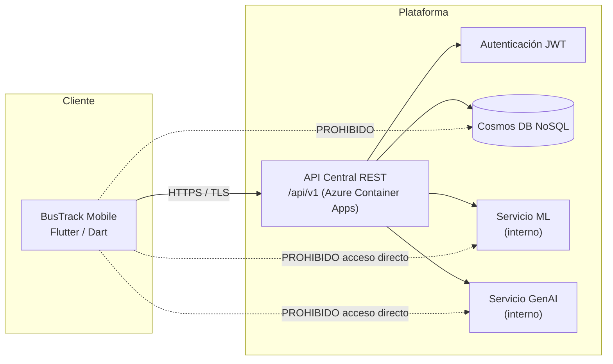
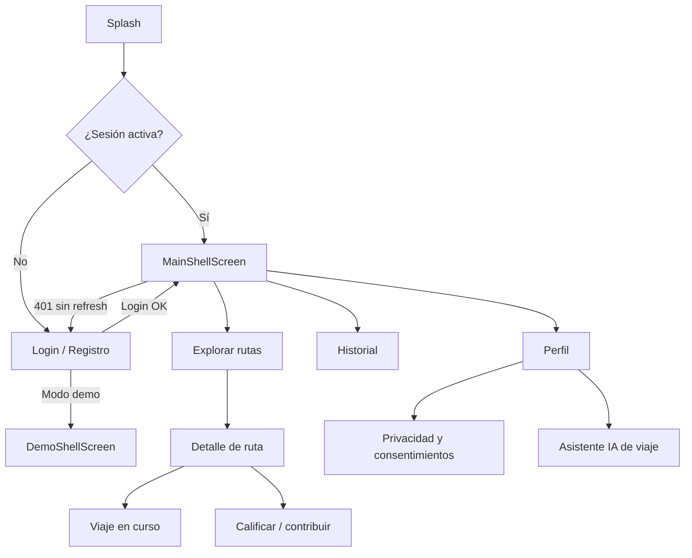
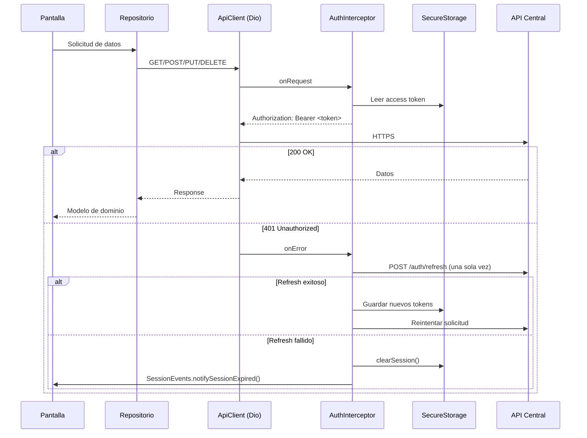

# BusTrack Mobile — Documentación Integral de Desarrollo

> **Documento para la Tesina General del Proyecto BusTrack**
> **Repositorio:** `bustrack-mobile` · **Paquete Android:** `com.bustrackapp`
> **Versión documentada de la app:** `1.1.0+4`
> **Fecha de consolidación:** 2026-11-25
> **Estado:** Documento vivo. Refleja el estado real del código y de la configuración del repositorio; no declara funcionalidades que no existan en código o pruebas.

---

## Índice

1. [Propósito y alcance del documento](#1-propósito-y-alcance-del-documento)
2. [Contexto del ecosistema BusTrack](#2-contexto-del-ecosistema-bustrack)
3. [Stack tecnológico](#3-stack-tecnológico)
4. [Configuración inicial del proyecto](#4-configuración-inicial-del-proyecto)
5. [Configuración de entornos](#5-configuración-de-entornos)
6. [Arquitectura de la aplicación](#6-arquitectura-de-la-aplicación)
7. [Seguridad de la aplicación](#7-seguridad-de-la-aplicación)
8. [Privacidad y protección de datos](#8-privacidad-y-protección-de-datos)
9. [Reglas de código y convenciones](#9-reglas-de-código-y-convenciones)
10. [Calidad, pruebas y CI/CD](#10-calidad-pruebas-y-cicd)
11. [Construcción de producción y Google Play](#11-construcción-de-producción-y-google-play)
12. [Historial de cambios en producción](#12-historial-de-cambios-en-producción)
13. [Integración con la API central](#13-integración-con-la-api-central)
14. [Sistema de diseño y accesibilidad](#14-sistema-de-diseño-y-accesibilidad)
15. [Procedimientos operativos](#15-procedimientos-operativos)
16. [Alcance entregado y evolución planificada](#16-alcance-entregado-y-evolución-planificada)
17. [Trazabilidad SDD y documentación relacionada](#17-trazabilidad-sdd-y-documentación-relacionada)
18. [Anexos](#18-anexos)

---

## 1. Propósito y alcance del documento

Este documento consolida, en un solo archivo, la documentación de desarrollo de la aplicación móvil **BusTrack Mobile**, con el nivel de detalle necesario para integrarse en la Tesina General del proyecto BusTrack.

Incluye:

- Las **configuraciones iniciales** del proyecto (herramientas, dependencias, estructura, entornos).
- La **arquitectura** y la organización del código.
- Las **reglas de código y de calidad** que rigen el repositorio.
- Las **políticas de seguridad y privacidad** aplicadas al cliente móvil.
- Los **cambios de producción**, el versionamiento y la publicación en Google Play.
- El **estado de integración** con la API central y el alcance funcional entregado.

**Criterio de veracidad:** toda afirmación se apoya en archivos del repositorio (`pubspec.yaml`, `lib/`, `android/`, `.github/`, `docs/`, `specs/`, `Memoria.md`). Cuando un documento normativo y el código difieren, se señala la diferencia y se identifica cuál es el estado real.

---

## 2. Contexto del ecosistema BusTrack

BusTrack es un sistema metropolitano de consulta y planificación de transporte público. La aplicación móvil es un **cliente** del ecosistema, no un servicio de datos.



### 2.1 Responsabilidades de la app

- Consumir **exclusivamente** la API central por HTTPS/REST.
- Mantener una responsabilidad delimitada: presentación, validación local y orquestación de consultas.
- No duplicar datos ni lógica que pertenecen a otro servicio.
- Aplicar **SDD** (Spec-Driven Development): toda funcionalidad nace de una especificación aprobada.

### 2.2 Límites explícitos (constitución del repositorio)

| Límite | Regla |
|---|---|
| Acceso a base de datos | Prohibido el acceso directo a Cosmos DB. |
| Servicios internos | Prohibido llamar directamente a ML o GenAI. |
| Rastreo | Prohibido el rastreo GPS continuo de usuarios o unidades. |
| Sensores | Prohibida la captura sin consentimiento explícito y revocable. |
| Datos | Prohibido inventar rutas, horarios, tarifas, empresas o destinos. |
| Secretos | Prohibido incluir secretos en el repositorio; viven en variables de entorno o gestores de secretos. |
| Infraestructura | No se declaran recursos Azure desplegados sin evidencia. |

---

## 3. Stack tecnológico

### 3.1 Stack actual de la aplicación

| Componente | Tecnología / Versión | Uso |
|---|---|---|
| Framework | Flutter (stable) | Aplicación móvil multiplataforma. |
| Lenguaje | Dart `>=3.0.0 <4.0.0` | Código de la app. |
| Cliente HTTP | `dio ^5.7.0` | Peticiones REST, interceptores y manejo de errores. |
| Almacenamiento seguro | `flutter_secure_storage 11.2.0` | Tokens JWT y datos mínimos de sesión. |
| Mapas | `flutter_map ^8.3.2` + `latlong2 ^0.10.1` | Mapa interactivo con OpenStreetMap. |
| Geolocalización | `geolocator ^14.1.2` | Ubicación en primer plano, opcional. |
| Iconografía | `cupertino_icons ^1.0.6` | Iconos complementarios. |
| Lint | `flutter_lints ^3.0.0` | Reglas de análisis estático. |
| Pruebas | `flutter_test` | Pruebas unitarias y de widgets. |

### 3.2 Toolchain de compilación Android

| Elemento | Valor documentado |
|---|---|
| Java | 17 (Temurin) |
| Gradle | 9.5.0 |
| Android Gradle Plugin | 9.1.1 |
| Kotlin | 2.4.0 |
| DSL Gradle | Kotlin (`build.gradle.kts`) |
| `applicationId` / `namespace` | `com.bustrackapp` |
| Salida de release | `build/app/outputs/bundle/release/app-release.aab` |

> **Nota:** `compileSdk`, `minSdk` y `targetSdk` se heredan de los valores de Flutter (`flutter.compileSdkVersion`, `flutter.minSdkVersion`, `flutter.targetSdkVersion`). La guía normativa del proyecto fija como objetivo **minSdk 24** y **compile/targetSdk 36** (Android 16) para cumplir los requisitos de Google Play 2026; debe verificarse el valor efectivo antes de cada publicación.

### 3.3 Stack legado (referencia funcional)

El repositorio conserva la implementación original en **Kotlin + Jetpack Compose** (Koin, Retrofit/OkHttp, kotlinx.serialization, EncryptedSharedPreferences, Kover, Detekt y Ktlint) como referencia funcional de la migración. La tecnología objetivo y el desarrollo activo son **Flutter + Dart**.

---

## 4. Configuración inicial del proyecto

### 4.1 Requisitos previos del entorno

1. **Flutter SDK** en canal `stable`.
2. **Dart** incluido con Flutter.
3. **JDK 17** para compilar Android.
4. **Android SDK** con las plataformas requeridas por Flutter (o compilación en la nube vía GitHub Actions).
5. **Git** y acceso al repositorio `bustrack0102/bustrack-mobile`.
6. **PowerShell 5.1+** para el script de validación SDD (`scripts/check_sdd.ps1`).

### 4.2 Archivo de proyecto (`pubspec.yaml`)

```yaml
name: bustrack_mobile
description: "BusTrack Mobile - Sistema de consulta y planificación de transporte público metropolitano."
publish_to: "none"
version: 1.1.0+4

environment:
  sdk: ">=3.0.0 <4.0.0"

dependencies:
  flutter:
    sdk: flutter
  cupertino_icons: ^1.0.6
  flutter_map: ^8.3.2
  latlong2: ^0.10.1
  geolocator: ^14.1.2
  dio: ^5.7.0
  flutter_secure_storage: 11.2.0

dev_dependencies:
  flutter_test:
    sdk: flutter
  flutter_lints: ^3.0.0

flutter:
  uses-material-design: true
  assets:
    - assets/images/
```

Reglas asociadas:

- `version: X.Y.Z+<buildNumber>`: el `buildNumber` es el `versionCode` de Android y **debe incrementarse en cada envío** a Google Play.
- `publish_to: "none"` impide publicar el paquete en pub.dev.
- Los assets se limitan a `assets/images/`; el logotipo oficial vive en `assets/images/logo.png`.

### 4.3 Análisis estático (`analysis_options.yaml`)

```yaml
analyzer:
  errors:
    deprecated_member_use: ignore
  exclude:
    - build/**
    - web/**
    - android/**
include: package:flutter_lints/flutter.yaml

linter:
  rules:
    prefer_const_constructors: true
    prefer_const_declarations: true
    avoid_print: true
```

Reglas efectivas relevantes:

- `avoid_print: true`: prohíbe `print` en el código de la app.
- `prefer_const_constructors` y `prefer_const_declarations`: favorecen widgets y valores constantes.
- Se excluyen `build/`, `web/` y `android/` del análisis Dart.

### 4.4 Formato y estilo (`.editorconfig`)

| Regla | Valor |
|---|---|
| Codificación | UTF-8 |
| Fin de línea | LF |
| Nueva línea final | Obligatoria |
| Espacios al final | Prohibidos |
| Longitud máxima de línea | 160 |
| Estilo Kotlin | `official` / `android_studio` |

El formato Dart es obligatorio y verificable con:

```bash
dart format --output=none --set-exit-if-changed .
```

### 4.5 Estructura inicial de carpetas

```text
bustrack-mobile/
├── android/                 # Proyecto Android nativo (Flutter)
├── assets/images/           # Logotipo y recursos visuales
├── docs/                    # Documentación viva y guías
├── lib/                     # Código Dart de la aplicación
├── scripts/                 # Automatización (puerta SDD)
├── specs/                   # Especificaciones de funcionalidades
├── specs-endpoints/         # Especificaciones de endpoints
├── test/                    # Pruebas unitarias y de widgets
├── .github/workflows/       # CI/CD (GitHub Actions)
├── .semgrep/rules/          # Reglas SAST
├── analysis_options.yaml
├── constitution.md
├── AGENTS.md
├── Memoria.md
├── CHECKLIST_PR.md
└── pubspec.yaml
```

### 4.6 Comandos base del proyecto

```bash
# Dependencias
flutter pub get

# Formato (falla si hay cambios pendientes)
dart format --output=none --set-exit-if-changed .

# Análisis estático
flutter analyze

# Pruebas
flutter test

# Cobertura
flutter test --coverage

# Validación SDD
pwsh -File scripts/check_sdd.ps1

# Compilación Android de producción
flutter build appbundle --release
```

### 4.7 Flujo SDD obligatorio

Toda funcionalidad sigue este ciclo:

1. `spec.md`: objetivo, alcance, requisitos y criterios de aceptación.
2. `plan.md`: estrategia, componentes, archivos, riesgos y pruebas.
3. `task.md`: tareas atómicas con archivos y criterio de terminado.
4. `chart.md`: diagramas de flujo, arquitectura y secuencia.
5. Implementación y pruebas.
6. Actualización de `Memoria.md` y documentos vivos.

Cada especificación debe incluir el bloque `## Aprobación` y su carpeta `checklists/`. La puerta automatizada `scripts/check_sdd.ps1` valida:

- Existencia de `constitution.md`, `AGENTS.md`, `Memoria.md` y `CHECKLIST_PR.md`.
- Existencia de `spec.md`, `plan.md`, `task.md`, `chart.md` y `checklists/` por spec.
- Bloque de aprobación en specs y specs-endpoints.
- Resultado esperado: `SDD-OK`.

### 4.8 Ramas y Pull Requests

| Tipo de rama | Convención |
|---|---|
| Funcionalidad | `feat/<spec-id>-<slug>` |
| Corrección | `fix/<slug>` |
| Documentación | `docs/<slug>` |

Reglas:

- Todo PR enlaza su spec y completa `CHECKLIST_PR.md`.
- No se hace commit, push ni despliegue sin autorización explícita.
- No se marca una tarea como completada solo por documentarla.

---

## 5. Configuración de entornos

La app define entornos en `lib/core/config/api_config.dart` mediante el enum `ApiEnvironment`:

| Entorno | URL por defecto | Uso |
|---|---|---|
| `produccion` | `https://api.bustrack.lat` | Producción oficial. |
| `desarrollo` | `https://localhost:5001` | Desarrollo local con HTTPS. |
| `dockerLocal` | `http://localhost:8080` | Contenedor local (solo desarrollo). |
| `azureContainerApps` | `https://bustrack-api.wonderfulpebble-cdcb3396.northcentralus.azurecontainerapps.io` | Entorno activo por defecto. |

La URL puede sobrescribirse en tiempo de compilación con:

```bash
flutter build appbundle --release \
  --dart-define=BUSTRACK_API_URL=https://api.bustrack.lat
```

### 5.1 Parámetros de red actuales

| Parámetro | Valor en código |
|---|---|
| Timeout de conexión | 15 s |
| Timeout de recepción | 15 s |
| Versión de API enviada | `X-API-Version: 1.0` |
| Cabeceras base | `Accept: application/json`, `Content-Type: application/json` |

> **Valores canónicos del cliente:** 15 s de conexión y 15 s de recepción, definidos en `ApiConfig` y aplicados por `ApiClient` en todas las peticiones.

### 5.2 Separación Dev/Prod

| Aspecto | Desarrollo | Producción |
|---|---|---|
| HTTPS | Permitido local | Obligatorio |
| Logs de consola | Sanitizados | Sin tokens ni PII |
| Tráfico claro (HTTP) | Solo `localhost` | Bloqueado por `network_security_config.xml` |
| Secretos | Variables locales no versionadas | GitHub Secrets / gestor de secretos |

---

## 6. Arquitectura de la aplicación

### 6.1 Enfoque: feature-first

La app sigue una arquitectura **feature-first** con separación por capas dentro de cada funcionalidad:

```text
lib/
├── core/
│   ├── config/        # ApiConfig y constantes de entorno
│   ├── map/           # Infraestructura reutilizable de mapas
│   ├── network/       # ApiClient, interceptores, excepciones, eventos de sesión
│   ├── storage/       # SecureStorageService
│   ├── theme/         # Colores, tipografía y ThemeData
│   └── widgets/       # Componentes globales reutilizables
├── features/
│   ├── auth/          # Autenticación, registro, recuperación, verificación
│   ├── demo/          # Modo demostración aislado del backend
│   ├── discover/      # Empresas, medios de transporte y destinos
│   ├── feedback/      # Calificaciones y contribuciones
│   ├── history/       # Historial de viajes
│   ├── home/          # Shell principal y navegación
│   ├── profile/       # Perfil, privacidad y consentimientos
│   ├── routes/        # Rutas, paradas, detalle, administración y asistente IA
│   ├── sensors/       # Acelerómetro, consentimiento y estado del sensor
│   ├── splash/        # Pantalla de arranque
│   └── trip/          # Viaje en curso
└── main.dart          # Coordinador de navegación y arranque
```

Cada feature puede contener:

- `data/`: data sources remotos, repositorios concretos y modelos de transporte (DTOs).
- `domain/`: contratos, modelos de dominio y servicios.
- `presentation/`: pantallas y widgets de la funcionalidad.

### 6.2 Flujo de arranque y navegación

`lib/main.dart` actúa como coordinador:

1. Muestra `SplashScreen`.
2. Consulta `SecureStorageService.hasActiveSession()`.
3. Si hay sesión, entra al shell principal; si no, presenta login/registro o modo demo.
4. `MainShellScreen` agrupa la navegación principal con `NavigationBar` (Explorar, Historial, Perfil).
5. Los eventos de sesión expirada se comunican a la UI mediante `SessionEvents` y regresan al login con aviso.



### 6.3 Capa de red



Componentes clave:

| Archivo | Responsabilidad |
|---|---|
| `lib/core/network/api_client.dart` | Cliente Dio singleton, cabeceras base, timeouts y mapeo de errores. |
| `lib/core/network/auth_interceptor.dart` | Inyección del Bearer token y renovación silenciosa con `Completer` compartido. |
| `lib/core/network/api_exceptions.dart` | Excepciones tipadas: `BadRequestException`, `UnauthorizedException`, `ForbiddenException`, `NotFoundException`, `ConflictException`, `RateLimitException`, `ServerException`, `NetworkException`. |
| `lib/core/network/session_events.dart` | Notificación de sesión expirada hacia la UI. |
| `lib/core/storage/secure_storage_service.dart` | Persistencia cifrada de tokens y datos mínimos del usuario. |

#### Mapeo de errores HTTP

| Código | Excepción / mensaje al usuario |
|---|---|
| 400 | `BadRequestException` con mensaje del backend. |
| 401 | `UnauthorizedException`: credenciales incorrectas o sesión expirada. |
| 403 | `ForbiddenException`: sin permiso. |
| 404 | `NotFoundException`: recurso no encontrado. |
| 409 | `ConflictException`. |
| 429 | `RateLimitException`: demasiadas solicitudes. |
| 500/502/503 | `ServerException`: servicio temporalmente no disponible. |
| Timeout / sin conexión | `NetworkException`: revisar conexión. |

### 6.4 Persistencia segura

`SecureStorageService` guarda únicamente:

- `jwt_access_token`
- `jwt_refresh_token`
- `user_id`
- `user_name`
- `user_email`
- `user_role`

Características:

- `flutter_secure_storage` v11 usa cifrado con **AES-GCM + RSA-OAEP** respaldado por Android Keystore.
- `clearSession()` borra **solo** las claves de autenticación; no usa `deleteAll()`.
- No se almacenan contraseñas.

> **Nota de migración:** el cambio a `flutter_secure_storage` 11.2.0 implicó un nuevo esquema de cifrado; los usuarios con sesiones del esquema anterior deben volver a iniciar sesión una vez.

### 6.5 Mapas

- Proveedor: **OpenStreetMap** mediante `flutter_map` (sin API key ni facturación).
- Tiles: `https://tile.openstreetmap.org/{z}/{x}/{y}.png`.
- `userAgentPackageName = com.bustrackapp`.
- Atribución OSM visible de forma obligatoria.
- Ubicación opcional y solo en primer plano; si se niega el permiso, el mapa funciona con el centro por defecto.
- No se envían coordenadas del usuario a la API central.
- Capa reutilizable en `lib/core/map/`: modelos (`GeoPoint`, `AppMapMarker`, `AppRoutePolyline`), `map_config.dart`, `map_utils.dart`, `map_controller_service.dart`, `location_service.dart` y `map_view.dart`.

### 6.6 Sensores y consentimiento

- `AccelerometerService` gestiona consentimiento, revocación, muestreo y clasificación de patrones.
- `grantConsent()` habilita la captura; `revokeConsent()` detiene el sensor y limpia el búfer.
- Muestreo configurado a **5 Hz** (cada 200 ms) con búfer máximo de 25–30 muestras.
- Envío de lotes a `POST /api/v1/sensores/lotes` solo si existe consentimiento.
- Estados de clasificación: reposo, movimiento continuo, cambio de movimiento y posible detención.

> **Alcance del módulo:** el servicio procesa ventanas de muestras triaxiales a 5 Hz y clasifica patrones de movimiento en tiempo real. La adquisición está desacoplada del análisis, de modo que la fuente de muestras puede conectarse al acelerómetro físico del dispositivo sin modificar la lógica de clasificación ni el contrato de envío por lotes. El consentimiento y la revocación están implementados y son obligatorios antes de cualquier captura.

### 6.7 Modo demostración

- Vive en `lib/features/demo/` y está **aislado del backend**.
- Usa `DemoMockData` y no solicita permisos de dispositivo ni acelerómetro.
- Los datos demo se etiquetan visualmente (`DemoDataBadge`, `MapConfig.demoNotice`).
- Regla de honestidad: no se simulan posiciones de autobuses ni ETA en tiempo real; cuando no hay datos reales, la interfaz lo indica.

---

## 7. Seguridad de la aplicación

La app adopta como referencia **OWASP MASVS L2** y un enfoque DevSecOps. Las reglas son normativas para todo el equipo.

### 7.1 Autenticación y sesión

- JWT con **access token de vida corta** y **refresh token**.
- Renovación silenciosa ante `401` mediante un único `POST /api/v1/auth/refresh` concurrente (protegido por `Completer`).
- Si la renovación falla: se limpia la sesión local y se notifica a la UI.
- **Logout local-first:** se limpian las credenciales locales de inmediato antes de completar la llamada de red, evitando sesiones huérfanas.
- Validación server-driven de expiración; la app no decide por sí sola la vigencia del token.

### 7.2 Almacenamiento seguro

| Regla | Implementación |
|---|---|
| Cero texto plano | Uso exclusivo de `flutter_secure_storage`. |
| Cifrado respaldado por hardware | Android Keystore con AES-GCM + RSA-OAEP. |
| Sin contraseñas | Nunca se persiste la contraseña. |
| Borrado acotado | `clearSession()` elimina solo claves de autenticación. |
| Respaldos | `android:allowBackup="false"`. |

Prohibido:

- Guardar tokens o contraseñas en `SharedPreferences` estándar.
- Incluir API keys, secretos o contraseñas en Dart, Gradle o el repositorio.

### 7.3 Comunicación segura

- **HTTPS obligatorio** en producción.
- `android/app/src/main/res/xml/network_security_config.xml` bloquea tráfico claro:

```xml
<network-security-config>
    <base-config cleartextTrafficPermitted="false">
        <trust-anchors>
            <certificates src="system" />
        </trust-anchors>
    </base-config>
</network-security-config>
```

- Timeouts definidos para evitar esperas indefinidas.
- Prohibido mostrar al usuario trazas, excepciones internas o detalles de Azure.

### 7.4 Logs y tratamiento de errores

- Prohibido registrar tokens, contraseñas, claves o PII.
- `avoid_print: true` en el linter.
- Las reglas Semgrep detectan impresiones de variables con nombres sensibles.
- Solo se registran códigos de estado y `CorrelationId` sanitizados (cuando aplique).
- Los errores se traducen a mensajes amigables en español.

### 7.5 Protección de formularios

- Validación local previa (correo con formato válido, contraseña mínima de 8 caracteres con letras y números).
- Bloqueo de doble envío: el botón se deshabilita mientras hay una llamada asíncrona activa.
- Contraseña oculta por defecto con control accesible para mostrar/ocultar.
- No se registra el contenido de los campos sensibles.

### 7.6 Endurecimiento de Android

| Control | Estado |
|---|---|
| `android:allowBackup="false"` | Activo. |
| `networkSecurityConfig` con `cleartextTrafficPermitted="false"` | Activo. |
| `android:debuggable="true"` en producción | Prohibido y detectado por Semgrep. |
| Permisos innecesarios | Prohibidos. |
| Firma de release con Upload Key | Configurada y validada en CI. |
| R8 / minify | La build release de Flutter usa **compilación AOT nativa**; la minificación R8 se mantiene desactivada para preservar la compatibilidad con Gradle 9.5 y los plugins del proyecto. |

### 7.7 Gestión de secretos

- Los secretos **nunca** se versionan.
- `.gitignore` excluye `.jks`, `.keystore`, `.p12`, `.pfx`, `.pem`, `.key`, `.env`, `key.properties`, `keys.properties` y `signing/`.
- En CI se usan **GitHub Secrets**.
- La firma local usa `android/key.properties` o variables de entorno.
- La build de release **aborta** si la firma está incompleta.

### 7.8 Matriz de permisos Android

| Permiso | Nivel | Justificación | Momento de solicitud |
|---|---|---|---|
| `ACCESS_FINE_LOCATION` / `ACCESS_COARSE_LOCATION` | Peligroso | Centrar el mapa y calcular paradas cercanas. Opcional. | Al pulsar «Mi ubicación» o una función que lo requiera. |
| `INTERNET` | Normal | Consultas a la API central. | Instalación. |
| `ACCESS_NETWORK_STATE` | Normal | Detección de conectividad (si se usa). | Instalación. |

Permisos **prohibidos**:

- `ACCESS_BACKGROUND_LOCATION`
- `CAMERA` y `RECORD_AUDIO` (no se requiere captura multimedia)
- `READ_CONTACTS` / `READ_CALL_LOG`
- `READ_EXTERNAL_STORAGE` / `MANAGE_EXTERNAL_STORAGE`

### 7.9 Checklist ASVS L2 aplicado

| Categoría | Evidencia |
|---|---|
| V2 Autenticación | Login validado en dominio, sin enumeración de usuarios, mensajes genéricos. |
| V3 Sesión | Expiración server-driven, token solo en almacenamiento seguro, limpieza en logout/expiración. |
| V4 Control de acceso | Denegación por defecto y errores tipados. |
| V6 Criptografía | Almacenamiento cifrado, `allowBackup=false`, claves solo por entorno. |
| V7 Errores y logs | Logs sanitizados, sin detalles internos al usuario. |
| V10 Configuración | `debuggable=false`, `allowBackup=false`, cleartext bloqueado. |

### 7.10 SAST con Semgrep

Reglas locales en `.semgrep/rules/semgrep.yaml`:

| Regla | Severidad | Objetivo |
|---|---|---|
| `bustrack-dart-no-hardcoded-secret` | ERROR | Evitar secretos hardcodeados (MASVS-STORAGE-1). |
| `bustrack-dart-insecure-http` | ERROR | Evitar HTTP fuera de localhost (MASVS-NET-1). |
| `bustrack-dart-print-sensitive` | WARNING | Evitar imprimir tokens/credenciales (MASVS-STORAGE-2). |
| `bustrack-android-no-debuggable` | ERROR | Evitar `android:debuggable="true"` en producción. |

Un hallazgo nuevo bloquea la fusión del PR.

---

## 8. Privacidad y protección de datos

### 8.1 Principios

- **Minimización de datos:** solo correo, nombre y datos necesarios para la cuenta.
- **Finalidad explícita:** autenticación, consulta de rutas, favoritos e historial.
- **Transparencia:** aviso de privacidad y términos accesibles desde registro, login y perfil.
- **Consentimiento de sensores:** explícito, previo y revocable.
- **Ubicación:** opcional, en primer plano y sin rastreo continuo.

### 8.2 Datos tratados

| Dato | Finalidad | Almacenamiento |
|---|---|---|
| Nombre completo | Identificación del usuario. | Backend + almacenamiento seguro local mínimo. |
| Correo electrónico | Autenticación y contacto. | Backend + almacenamiento seguro local. |
| Contraseña | Autenticación. | Solo backend (hash); nunca en la app. |
| Tokens JWT | Sesión. | Almacenamiento cifrado del dispositivo. |
| Ubicación | Centrar mapa y paradas cercanas (opcional). | No se envía a la API; no se persiste. |
| Acelerómetro | Detección de patrones de movimiento (con consentimiento). | Búfer en memoria; envío por lotes al backend. |

### 8.3 Eliminación de cuenta

Flujo implementado:

1. El usuario entra a Perfil → Privacidad → «Eliminar mi cuenta».
2. Se muestra un diálogo con consecuencias irreversibles.
3. Se solicita confirmación (contraseña y acción destructiva).
4. Se invoca `DELETE /api/v1/usuarios/me`.
5. Si el servidor responde con éxito, se purga el almacenamiento local y se regresa a la pantalla de bienvenida.
6. Si falla, **no se simula éxito**; se informa del error y se ofrece el canal alternativo.

Google Play exige además una **URL externa pública** de eliminación de cuenta (documentada como `https://bustrack.com/privacidad/eliminar-cuenta`).

### 8.4 Declaración Data Safety (Google Play)

Debe declarar de forma concordante con la app:

- Ubicación opcional, solo en primer plano, no compartida con terceros.
- Correo electrónico para identificación de cuenta.
- Datos de sensores (acelerómetro) bajo consentimiento.
- Eliminación de cuenta disponible dentro de la app y por URL externa.

---

## 9. Reglas de código y convenciones

### 9.1 Convenciones generales

| Regla | Detalle |
|---|---|
| Idioma de identificadores | Inglés. |
| Idioma de documentación y UI | Español. |
| Arquitectura | Feature-first con capas `data`, `domain`, `presentation`. |
| Formato | `dart format` obligatorio. |
| Lint | `flutter analyze` sin issues. |
| Constantes | Preferir `const` cuando aplique. |
| Impresiones | Prohibido `print`; usar logging sanitizado si es necesario. |
| TODO | Prohibido `TODO` sin issue asociado. |
| Código muerto | Prohibido dejar placeholders o código sin uso. |
| Dependencias | Solo las aprobadas; no introducir frameworks o servicios no autorizados. |
| Secretos | Prohibidos en código, fixtures, logs y repositorio. |

### 9.2 Reglas de UI

1. **Fidelidad cromática:** usar únicamente los tokens de `AppColors`; no usar colores hexadecimales libres en widgets.
2. **Widgets globales:** usar `AppButton`/`PrimaryButton`, `CustomTextField`, `AppCard`, `AppDropdown`, `AppStates`, etc., de `lib/core/widgets/`.
3. **Estados deterministas:** toda pantalla debe manejar carga, éxito, vacío, error y sin conexión; nunca congelarse ni quedar en blanco.
4. **Accesibilidad:** áreas táctiles mínimas de 48×48 dp, contraste WCAG AA, escalado de texto hasta 1.5x, semántica para TalkBack y estados no dependientes solo del color.
5. **Teclado:** formularios envueltos en scroll y `resizeToAvoidBottomInset` para evitar oclusión.
6. **Orientación:** vertical (`portraitUp`) como estándar operativo.
7. **Privacidad:** no solicitar permisos hasta que el usuario acceda a la funcionalidad que los requiere.
8. **Trazabilidad:** toda pantalla nueva nace de un spec aprobado y se registra en `Memoria.md`.

### 9.3 Reglas de datos y red

- La app consume **solo** la API central; nunca Cosmos DB, ML o GenAI directamente.
- Los DTOs se parsean de forma defensiva; los campos ausentes no deben inventarse.
- Una lista vacía es un resultado válido; no debe tratarse como error.
- Los fallbacks a datos demo deben ser visibles para el usuario y no silenciosos.
- Los errores HTTP se mapean a excepciones tipadas y mensajes amigables.
- No se registran cuerpos de respuesta con datos sensibles.

### 9.4 Reglas de seguridad en código

- No hardcodear tokens, contraseñas, API keys ni URLs con credenciales.
- No usar HTTP en producción.
- No habilitar `android:debuggable` en release.
- No persistir PII más allá de lo mínimo necesario.
- No capturar sensores sin consentimiento.
- No solicitar ubicación en segundo plano.

### 9.5 Checklist de Pull Request

El archivo `CHECKLIST_PR.md` es obligatorio y cubre:

- **Spec y alcance:** cuatro archivos SDD, alcance respetado, `Memoria.md` actualizado.
- **Arquitectura:** tecnología objetivo, dependencias aprobadas, contratos respetados.
- **Calidad:** formato, lint, build, sin código muerto ni secretos.
- **Seguridad:** entradas validadas, auth revisada, Semgrep limpio, dependencias escaneadas.
- **Pruebas:** unitarias, integración/contrato y seguridad cuando aplique, con evidencia.
- **Documentación:** README, endpoints y contratos actualizados.
- **Integración:** compatibilidad con otros repos y variables de entorno documentadas.
- **Revisión:** CI en verde y autorización para commit/push/despliegue.

---

## 10. Calidad, pruebas y CI/CD

### 10.1 Estrategia de pruebas

| Tipo | Herramienta | Alcance |
|---|---|---|
| Unitarias | `flutter_test` | Modelos, servicios, utilidades, lógica de dominio. |
| Widgets | `flutter_test` | Pantallas y componentes de UI. |
| Contrato HTTP | Pruebas de serialización/deserialización | DTOs y payloads de la API. |
| Integración de flujos | Pruebas de widgets/navegación | Login, registro, navegación y estados. |
| Seguridad | Pruebas específicas + SAST | Sanitización, sesión y almacenamiento. |

Estado reportado más reciente en `Memoria.md`: **47/47 pruebas aprobadas**, `flutter analyze` con **0 issues**, `dart format` sin cambios y `scripts/check_sdd.ps1` con **SDD-OK**.

> Los tests triviales no cuentan como cobertura. Sin pruebas y evidencia de ejecución no se considera terminado.

### 10.2 Workflows de GitHub Actions

| Workflow | Disparador | Contenido |
|---|---|---|
| `ci.yml` | PR y push a `main` | Detecta stack, configura Flutter/Java, `pub get`, formato, analyze, tests con cobertura, SDD y Semgrep. |
| `ci-pr.yml` | PR y push a `main` | Misma puerta de calidad para PR. |
| `build-aab.yml` | Push a `main` y manual | Compila AAB release firmado, verifica firma y publica artefacto. |

Etapas efectivas de calidad:

```text
flutter pub get
dart format --output=none --set-exit-if-changed .
flutter analyze
flutter test --coverage
pwsh -File scripts/check_sdd.ps1
semgrep --config .semgrep/rules/semgrep.yaml
```

Reglas:

- Los gates de lint, pruebas y SAST son **bloqueantes**.
- La auditoría de dependencias es bloqueante salvo vulnerabilidad justificada y registrada.
- Los PR no usan secretos productivos.
- No se publican artefactos con PII ni secretos.
- La **entrega** se realiza con el AAB generado por el workflow `Build AAB` y se sube manualmente a Google Play Console como paso controlado de liberación.

### 10.3 Cobertura y reportes

- `flutter test --coverage` genera el reporte de cobertura.
- Los artefactos de prueba y cobertura se conservan como evidencia.
- La cobertura no se declara como métrica absoluta sin medición real.

---

## 11. Construcción de producción y Google Play

### 11.1 Identidad de la aplicación

| Elemento | Valor |
|---|---|
| Nombre | BusTrack |
| Paquete / `applicationId` | `com.bustrackapp` |
| Formato de entrega | Android App Bundle (`.aab`) |
| Firma de distribución | Google Play App Signing |
| Firma de subida | Upload Key propia |
| `versionName` | 1.1.0 |
| `versionCode` | 4 |

### 11.2 Upload Key vs. Play App Signing

- **Upload Key:** clave privada con la que el equipo firma el AAB antes de subirlo. Debe conservarse y respaldarse.
- **App Signing Key:** la administra Google Play y firma la app que reciben los dispositivos. No se posee ni se sube.

### 11.3 Generación de la Upload Keystore (una sola vez)

```bash
keytool -genkeypair \
  -alias upload \
  -keyalg RSA \
  -keysize 2048 \
  -validity 10000 \
  -storetype JKS \
  -keystore upload-keystore.jks \
  -dname "CN=BusTrack Upload, O=BusTrack, C=MX"
```

Reglas:

- Guardar el `.jks` **fuera del repositorio**, en al menos dos ubicaciones cifradas.
- No regenerar la clave para actualizaciones; debe ser la misma.
- Registrar contraseñas y alias en un gestor de secretos.

### 11.4 GitHub Secrets requeridos

| Secret | Contenido |
|---|---|
| `ANDROID_KEYSTORE_BASE64` | Keystore codificada en Base64 (una sola línea). |
| `ANDROID_KEYSTORE_PASSWORD` | Contraseña del keystore. |
| `ANDROID_KEY_PASSWORD` | Contraseña de la clave. |
| `ANDROID_KEY_ALIAS` | Alias (por ejemplo `upload`). |

### 11.5 Configuración de firma en Gradle

`android/app/build.gradle.kts`:

1. Lee primero variables de entorno (`ANDROID_KEYSTORE_PATH`, `ANDROID_KEYSTORE_PASSWORD`, `ANDROID_KEY_ALIAS`, `ANDROID_KEY_PASSWORD`).
2. Si no existen, lee `android/key.properties`.
3. Si se solicita una build release y la firma está incompleta, **aborta** con un mensaje explícito.
4. La configuración `release` usa la Upload Key solo si está completa.

### 11.6 Pipeline de AAB

`build-aab.yml` ejecuta:

1. `flutter doctor -v`
2. `flutter pub get`
3. `flutter analyze`
4. `flutter test`
5. Validación de los cuatro secretos.
6. Decodificación de la keystore y creación temporal de `key.properties` con permisos restringidos.
7. Verificación del alias con `keytool`.
8. `flutter build appbundle --release`
9. Verificación del AAB con `jarsigner -verify`.
10. Comparación de la huella **SHA-256** del AAB con la de la Upload Key.
11. Publicación del artefacto `app-release-aab-<run>` (retención 90 días).
12. Limpieza de archivos temporales con `if: always()`.

Si falta un secret o la firma no coincide, el job falla y **no publica** el artefacto.

### 11.7 Requisitos de Google Play Console

| Requisito | Criterio |
|---|---|
| Identificador único | `com.bustrackapp`, estable. |
| Nombre | «BusTrack» (≤ 30 caracteres). |
| Icono | 512×512 con fondo adaptativo. |
| Capturas | Alta resolución (1080×1920) de Login, Registro, Mapa y Rutas. |
| Gráfico promocional | 1024×500. |
| Privacidad | URL HTTPS pública. |
| Data Safety | Declaración concordante con la app. |
| Eliminación de cuenta | In-app y URL externa. |
| Permisos | Cero permisos innecesarios. |
| Formato | AAB firmado. |
| Pruebas | Dispositivos reales con Android 11–16. |

### 11.8 Flujo de publicación en Prueba Interna

1. Generar/verificar la Upload Keystore.
2. Registrar los cuatro GitHub Secrets.
3. Ejecutar `Build AAB` o `flutter build appbundle --release`.
4. Descargar `app-release.aab`.
5. Crear la app en Play Console (`BusTrack`, español, gratis).
6. Configurar la pista de **Prueba Interna** y la lista de testers.
7. Subir el AAB y crear la versión.
8. Completar «Contenido de la app»: privacidad, acceso, anuncios, público objetivo y Data Safety.
9. Iniciar el lanzamiento y compartir el enlace con los testers.

### 11.9 Regla obligatoria de versionamiento

> **Cada vez que se prepare o suba un cambio a Google Play Console es obligatorio incrementar el `versionCode` en `pubspec.yaml`.**

Formato: `version: X.Y.Z+<buildNumber>`, donde `<buildNumber>` debe ser estrictamente mayor al anterior.

Ejemplo: de `1.1.0+3` a `1.1.0+4`.

Google Play rechaza cualquier AAB que reutilice un código de versión ya subido.

---

## 12. Historial de cambios en producción

| Fecha | Versión | Cambio | Estado |
|---|---|---|---|
| 2026-11-11 | `1.0.0+1` | Prueba interna inicial; UI base, login, registro, OTP y modo demo. | Publicado en pista interna. |
| 2026-11-12 | `1.0.0+1` | Firma release, icono oficial, endurecimiento DevSecOps y conexión inicial. | Build validada. |
| 2026-11-17 | `1.1.0` | Conexión real con Azure, catálogos, refresh token atómico, correcciones de fallback y flujo de registro. | Verificado localmente. |
| 2026-11-25 | `1.1.0+2` | Conexión de perfil, viajes, calificaciones, consentimientos y sensores; preparación de Prueba Cerrada. | Build para Play Console. |
| 2026-11-25 | `1.1.0+3` | Corrección por rechazo de Google Play: el `versionCode` 2 ya había sido utilizado. Se documenta la regla permanente. | Rechazo resuelto con nuevo código. |
| 2026-11-25 | `1.1.0+4` | Asistente IA de Viaje, refinamiento visual e incremento de versión. | Versión documentada actual. |

### 12.1 Decisiones de producción relevantes

- **Paquete oficial:** se migró de `com.bustrack.mobile` a `com.bustrackapp` porque Google Play rechazó el AAB con un identificador distinto al registrado.
- **Firma:** se pasó de firmar con clave de depuración a una Upload Key dedicada con validación SHA-256.
- **Seguridad:** se añadieron `allowBackup=false`, bloqueo de cleartext, reglas Semgrep y verificación de firma.
- **R8:** se consolidó una configuración de release estable con compilación AOT de Flutter y minificación desactivada para garantizar compatibilidad con Gradle 9.5 y los plugins nativos.
- **Versionamiento:** se institucionalizó el incremento obligatorio de `versionCode` tras el rechazo de Play Console.

---

## 13. Integración con la API central

### 13.1 Principios de integración

- La API central es la **única fuente autorizada** de datos de transporte.
- Toda comunicación usa HTTPS, timeouts y errores tipados.
- Los contratos se documentan y versionan.
- Lo propuesto se marca como propuesto; no se declaran endpoints inexistentes.

### 13.2 Base URL y cabeceras

```text
Base URL por defecto (Azure Container Apps):
https://bustrack-api.wonderfulpebble-cdcb3396.northcentralus.azurecontainerapps.io

Cabeceras:
Accept: application/json
Content-Type: application/json
X-API-Version: 1.0
Authorization: Bearer <access_token>   (rutas protegidas)
```

### 13.3 Módulos de endpoints declarados

`lib/core/config/api_config.dart` centraliza las rutas. Los módulos son:

| Módulo | Ejemplos de rutas |
|---|---|
| Autenticación y usuarios | `/auth/login`, `/auth/registro`, `/auth/refresh`, `/auth/logout`, `/auth/recuperar-password`, `/auth/restablecer-password`, `/usuarios/me` |
| Empresas y medios | `/empresas`, `/empresas/autocompletar`, `/empresas/comparar`, `/medios-transporte` |
| Rutas, paradas y mapas | `/rutas`, `/rutas/buscar`, `/rutas/autocompletar`, `/paradas`, `/paradas/autocompletar`, `/paradas/cercanas`, `/mapa/elementos` |
| Horarios y tarifas | `/horarios`, `/horarios/siguiente`, `/tarifas`, `/tarifas/calcular` |
| Destinos | `/destinos`, `/destinos/autocompletar`, `/destinos/categorias` |
| Calificaciones, viajes y consentimientos | `/calificaciones`, `/calificaciones/resumen`, `/calificaciones/mias`, `/viajes`, `/consentimientos`, `/consentimientos/me` |
| Sensores, ML y GenAI | `/sensores/lotes`, `/telemetria/inferencia`, `/ml/clasificar-patron`, `/recomendaciones`, `/recomendaciones/historial` |
| Dispositivos, media y moderación | `/dispositivos`, `/dispositivos/mios`, `/media/upload`, `/moderacion` |
| Administración | `/candidatos-parada`, `/admin/candidatos-parada` |
| Salud y catálogos | `/health`, `/health/ready`, `/catalogos/estado-actualizacion` |

> **Trazabilidad de integración:** `ApiConfig` centraliza las rutas del contrato. El inventario de `docs/INTEGRACION-ENDPOINTS-MOBILE.md` registra el estado de cada integración (activa, en evolución o no habilitada) para mantener la correspondencia entre cliente y backend.

### 13.4 Estado de integración (resumen)

**Integraciones activas (según el inventario y `Memoria.md`):**

- Registro, login, refresh, logout, recuperación y restablecimiento de contraseña.
- Perfil: `GET`, `PUT` y `DELETE /api/v1/usuarios/me`.
- Catálogos: empresas, medios de transporte, rutas, búsqueda de rutas, paradas de ruta, autocompletado de paradas, geometría y cálculo de tarifas.
- Destinos turísticos.
- Calificaciones (`POST`), viajes (`GET`, `POST`, `DELETE`) y consentimientos (`GET`, `POST`, `DELETE`).
- Lotes de sensores (`POST /api/v1/sensores/lotes`).
- Asistente IA de viaje (`/recomendaciones` y su historial/retroalimentación).

**Integraciones en evolución:** rutas preparadas en `ApiConfig` cuya activación progresiva en UI/servicio se completa en las siguientes iteraciones:

- `empresas/autocompletar`, `mapa/elementos`, `horarios`, `horarios/siguiente`, `tarifas`, `destinos/autocompletar`, `destinos/categorias`, `catalogos/estado-actualizacion`, `health`.

**Rutas no habilitadas en el contrato vigente:** no forman parte de la API habilitada y no deben invocarse:

- `/asociaciones`, `/auth/2fa/*`, `/admin/bootstrap`, `/transporte/*`, `/auth/account`, `/auth/verificar-correo`.
- El contrato vigente no requiere verificación de correo por token: la cuenta queda activa desde el registro, por lo que el flujo OTP no forma parte de la navegación principal.

### 13.5 Errores uniformes esperados

| Código | Significado |
|---|---|
| 400 | Petición mal formada. |
| 401 | Credencial ausente o inválida. |
| 403 | Sin permiso. |
| 404 | Recurso inexistente. |
| 409 | Conflicto de concurrencia/unicidad. |
| 422 | Validación de dominio/esquema. |
| 429 | Rate limit. |
| 500 | Error interno sin detalles sensibles. |

---

## 14. Sistema de diseño y accesibilidad

### 14.1 Paleta oficial implementada (`AppColors`)

| Token | HEX | Uso |
|---|---|---|
| `primary` | `#CF1B1B` | Rojo intenso BusTrack; CTA y acentos. |
| `primaryDark` | `#900D0D` | Estados pressed/hover y rojo vino. |
| `secondary` | `#900D0D` | Tonos complementarios. |
| `tertiary` | `#FFDBC5` | Beige cálido para tarjetas y avisos. |
| `neutralDark` | `#333333` | Títulos y texto de alto contraste. |
| `surfaceWhite` | `#FFFFFF` | Fondo principal. |
| `textMuted` | `#64748B` | Texto secundario. |
| `inputBackground` | `#F8FAFC` | Fondo de campos. |
| `inputBorder` | `#E2E8F0` | Bordes de inputs. |
| `success` | `#059669` | Confirmaciones y estados activos. |
| `warning` | `#D97706` | Advertencias. |
| `error` | `#DC2626` | Errores y validaciones. |
| `offline` | `#475569` | Banner sin conexión. |
| `disabled` | `#E2E8F0` | Componentes deshabilitados. |
| `disabledText` | `#94A3B8` | Texto deshabilitado. |

> **Fuente única de verdad visual:** `lib/core/theme/app_colors.dart`. Toda pantalla consume estos tokens a través de `AppTheme`; no se permiten colores hexadecimales libres en los widgets.

### 14.2 Tipografía

- Familia: **Plus Jakarta Sans**.
- Escala definida en `lib/core/theme/app_typography.dart`.
- Tamaños escalables (`sp`) y compatibles con el escalado de texto del sistema.

### 14.3 Componentes globales

`lib/core/widgets/`:

- `app_buttons.dart`: botón primario, secundario y terciario.
- `custom_text_field.dart`: input accesible con estados reposo, foco, error y deshabilitado.
- `app_dropdown.dart`: selector accesible.
- `app_controls.dart`: checkboxes y switches con área táctil ≥ 48 dp.
- `app_card.dart`: tarjeta de contenido.
- `app_dialogs.dart`: confirmaciones y advertencias.
- `app_states.dart`: carga, error, sin conexión y vacío.
- `live_status_card.dart`: estado del servicio.
- `otp_field.dart`: casillas de verificación.
- `demo_data_badge.dart`: etiqueta de datos de demostración.
- `primary_button.dart`: botón principal.

### 14.4 Reglas de accesibilidad

- Contraste WCAG 2.1 AA mínimo; texto principal `#333333` sobre blanco ≈ 12.6:1.
- Áreas táctiles de 48×48 dp.
- Soporte de escalado de texto hasta 1.5x sin truncar.
- Semántica en español para TalkBack; iconos decorativos excluidos.
- Estados no dependientes únicamente del color.

### 14.5 Estados de interfaz

Toda pantalla debe gestionar:

1. **Inicial:** placeholders o esqueletos.
2. **Carga:** indicador sin bloquear la navegación.
3. **Éxito:** datos con transiciones fluidas.
4. **Vacío:** icono, título amigable y acción para reiniciar filtros.
5. **Error:** mensaje comprensible y botón «Reintentar».
6. **Sin conexión:** banner discreto y posibilidad de consultar datos cacheados.

---

## 15. Procedimientos operativos

### 15.1 Validación local antes de un PR

```bash
flutter pub get
dart format --output=none --set-exit-if-changed .
flutter analyze
flutter test
pwsh -File scripts/check_sdd.ps1
```

Criterio de salida: sin cambios de formato, 0 issues, todas las pruebas en verde y `SDD-OK`.

### 15.2 Compilación local de release

1. Crear `android/key.properties` (ignorado por Git):

```properties
storeFile=C:/ruta/segura/upload-keystore.jks
storePassword=TU_PASSWORD
keyAlias=upload
keyPassword=TU_KEY_PASSWORD
```

2. Compilar:

```bash
flutter build appbundle --release
```

3. Verificar la firma:

```bash
jarsigner -verify -verbose -certs build/app/outputs/bundle/release/app-release.aab
```

Resultado esperado: `jar verified.`

### 15.3 Compilación en la nube

1. Ir a `Actions → Build AAB`.
2. Ejecutar sobre `main` o hacer push a `main`.
3. Descargar el artefacto `app-release-aab-<run>`.
4. Confirmar `jarsigner -verify` antes de subirlo a Play Console.

### 15.4 Recuperación ante pérdida de la Upload Key

1. Si Play App Signing está habilitado, solicitar en Play Console el reinicio de la Upload Key (`App integrity → Upload key reset`).
2. Si no está habilitado y ya se publicó con esa clave, contactar al soporte de Google Play.
3. Generar una nueva keystore, actualizar los cuatro secretos y volver a ejecutar el workflow.

### 15.5 Diagnóstico de problemas frecuentes

| Síntoma | Causa probable | Acción |
|---|---|---|
| `Firma Release incompleta` | Faltan variables o `key.properties`. | Configurar los cuatro valores de firma. |
| Fallo de CI en formato | Archivos sin `dart format`. | Ejecutar `dart format .`. |
| `SDD-FAIL` | Falta `spec.md`, `plan.md`, `task.md`, `chart.md`, `checklists/` o bloque de aprobación. | Completar la estructura SDD. |
| Semgrep bloquea | HTTP, secreto hardcodeado o `debuggable="true"`. | Corregir el hallazgo. |
| Error de dependencias `geolocator` + `flutter_secure_storage` | Incompatibilidad de versiones antigua. | Usar `flutter_secure_storage 11.2.0`. |
| Usuarios piden login tras actualizar | Migración al nuevo esquema de cifrado. | Es esperado; volver a iniciar sesión. |
| Compilación release | Flutter usa AOT nativo y la minificación R8 está ajustada por compatibilidad de toolchain. | Compilar con `flutter build appbundle --release`; no forzar minificación sin validar ProGuard. |

---

## 16. Alcance entregado y evolución planificada

La versión documentada (`1.1.0+4`) entrega un cliente móvil funcional, integrado con la API central y preparado para su distribución en Google Play. La siguiente matriz resume el alcance entregado y las líneas de evolución previstas para las siguientes iteraciones.

| Módulo | Entrega funcional | Evolución planificada |
|---|---|---|
| Autenticación y sesión | Login, registro, refresh atómico, logout local-first y restauración de sesión con tokens en almacenamiento seguro. | Validación continua con el backend en producción. |
| Perfil, viajes, calificaciones y consentimientos | Operaciones conectadas a la API central: consulta y edición de perfil, eliminación de cuenta, historial de viajes, calificaciones y consentimientos. | Ampliación de métricas y filtros de historial. |
| Catálogos y mapa | Empresas, medios de transporte, rutas, paradas, geometría, tarifas, destinos y mapa interactivo con OpenStreetMap. | Nuevas capas cartográficas y paradas cercanas en el mapa. |
| Acelerómetro y movimiento | Consentimiento explícito y revocable, muestreo a 5 Hz, búfer acotado, clasificación de patrones y envío de lotes por API. | Conexión de la adquisición al hardware físico y anonimización previa al envío. |
| Servicio ML | Contrato de inferencia declarado y clasificación local de patrones como respaldo. | Validación con el servicio interno y ajuste de umbrales. |
| Asistente IA de viaje | Recomendaciones, historial y retroalimentación con fallback ante indisponibilidad. | Ampliación de preferencias y personalización. |
| Administración de rutas | Editor cartográfico funcional para crear rutas, colocar paradas, ordenar la secuencia y trazar polilíneas. | Persistencia del CRUD contra los endpoints administrativos. |
| Publicación en Google Play | AAB firmado, `versionCode` 4, guías de Prueba Interna y Data Safety completas. | Promoción a Prueba Cerrada y Producción. |
| Build de release | Compilación AOT nativa de Flutter con configuración estable para Gradle 9.5 y plugins del proyecto. | Evaluación de minificación R8 con reglas ProGuard validadas. |
| Calidad | 47 pruebas aprobadas, `flutter analyze` sin issues, formato verificado, puerta SDD y Semgrep en CI. | Umbral de cobertura y pruebas en matriz de dispositivos. |
| Distribución | Entrega manual del AAB mediante Google Play Console. | Automatización de la subida si el equipo lo aprueba. |

### 16.1 Consideraciones de ingeniería

1. **Adquisición desacoplada del análisis:** el servicio de movimiento separa la fuente de muestras del clasificador y del contrato de envío, lo que permite conectar el sensor físico del dispositivo sin reescribir la lógica de dominio.
2. **Contratos defensivos:** los DTOs toleran campos ausentes y los fallbacks a datos demo se etiquetan visualmente, preservando la claridad para el usuario.
3. **Resguardo de la Upload Key:** la clave y sus contraseñas se mantienen fuera del repositorio y en un gestor de secretos; su pérdida requiere el reinicio en Play Console.
4. **Versionamiento incremental:** la regla de incremento obligatorio de `versionCode` previene rechazos de Google Play por códigos reutilizados.

---

## 17. Trazabilidad SDD y documentación relacionada

### 17.1 Documentos rectores

| Documento | Función |
|---|---|
| `constitution.md` | Fuente de verdad arquitectónica y de seguridad. |
| `AGENTS.md` | Instrucciones permanentes para agentes y equipo. |
| `Memoria.md` | Registro vivo de decisiones, estado y riesgos. |
| `CHECKLIST_PR.md` | Checklist obligatorio de Pull Request. |
| `specs/README.md` | Índice y estado de las specs de funcionalidad. |
| `specs-endpoints/README.md` | Índice de specs de endpoints. |

### 17.2 Documentación técnica complementaria

| Documento | Contenido |
|---|---|
| `docs/configuracion-global-diseno-seguridad-playstore.md` | Guía maestra de diseño, seguridad, privacidad y Play Store. |
| `docs/android-release-signing.md` | Firma release y generación automatizada del AAB. |
| `docs/guia-prueba-interna-playstore.md` | Publicación paso a paso en Prueba Interna. |
| `docs/INTEGRACION-ENDPOINTS-MOBILE.md` | Inventario y auditoría de endpoints. |
| `docs/contratos-integracion.md` | Contratos consumidos y prohibiciones. |
| `docs/asvs-l2-checklist.md` | Evidencia ASVS L2. |
| `docs/map-integration.md` | Integración de mapas y pantallas. |
| `docs/ui-ux-primeras-pantallas.md` | Especificación UI/UX inicial. |
| `docs/rate-matrix.md` | Límites de red y paginación. |
| `cicd/pipeline.md` | Detalle del pipeline. |

### 17.3 Funcionalidades entregadas y su documentación SDD

| Módulo | Funcionalidad entregada | Documentación de referencia |
|---|---|---|
| Configuración y arquitectura | Proyecto Flutter, entornos, capa de red, almacenamiento seguro y navegación. | `specs/01-configuracion-inicial-del-proyecto`, `specs/02-arquitectura-base-flutter` |
| Autenticación y sesión | Login, registro, refresh, logout, recuperación y restablecimiento de contraseña. | `specs/04-autenticacion`, `specs/05-gestion-de-sesiones` |
| Catálogos | Empresas, medios de transporte, rutas, paradas y destinos. | `specs/06-consulta-de-empresas`, `specs/07-consulta-de-rutas`, `specs/08-consulta-de-paradas`, `specs/09-consulta-de-destinos` |
| Horarios, tarifas y mapa | Cálculo de tarifas, geometría de rutas y mapa interactivo. | `specs/10-consulta-de-horarios-y-tarifas`, `specs/11-mapa-de-consulta` |
| Calificaciones y comparación | Calificación de rutas y contribuciones del usuario. | `specs/12-comparacion-de-alternativas`, `specs/13-calificaciones` |
| Sensores y ML | Consentimiento, captura, clasificación de movimiento e integración por lotes. | `specs/14-captura-de-acelerometro-con-consentimiento`, `specs/15-integracion-con-servicio-ml` |
| Publicación | Firma, AAB, ficha y distribución en Google Play. | `specs/16-publicacion-en-google-play` |
| Endpoints | Contratos de autenticación, catálogos, viajes, calificaciones, consentimientos y sensores. | `specs-endpoints/17` a `specs-endpoints/25` |

---

## 18. Anexos

### Anexo A. Glosario

| Término | Definición |
|---|---|
| **AAB** | Android App Bundle; formato de entrega exigido por Google Play. |
| **API central** | Backend REST de BusTrack desplegado en Azure Container Apps. |
| **ASVS** | Application Security Verification Standard de OWASP. |
| **AOT** | Ahead-Of-Time; compilación nativa de Flutter en release. |
| **DTO** | Data Transfer Object; modelo de transporte entre API y app. |
| **JWT** | JSON Web Token; credencial de sesión firmada. |
| **MASVS** | Mobile Application Security Verification Standard de OWASP. |
| **SDD** | Spec-Driven Development; desarrollo guiado por especificaciones. |
| **SAST** | Static Application Security Testing; análisis estático de seguridad. |
| **Upload Key** | Clave con la que el equipo firma el AAB antes de subirlo a Google Play. |

### Anexo B. Comandos de referencia rápida

```bash
# Entorno
flutter --version
flutter doctor -v
flutter pub get

# Calidad
dart format --output=none --set-exit-if-changed .
flutter analyze
flutter test
flutter test --coverage
pwsh -File scripts/check_sdd.ps1

# Producción
flutter build appbundle --release
jarsigner -verify -verbose -certs build/app/outputs/bundle/release/app-release.aab
keytool -printcert -jarfile build/app/outputs/bundle/release/app-release.aab
```

### Anexo C. Variables y secretos

| Variable | Ámbito | Uso |
|---|---|---|
| `BUSTRACK_API_URL` | Compilación (`--dart-define`) | Sobrescribe la URL base. |
| `ANDROID_KEYSTORE_PATH` | Entorno / CI | Ruta a la keystore. |
| `ANDROID_KEYSTORE_PASSWORD` | Entorno / CI | Contraseña del keystore. |
| `ANDROID_KEY_ALIAS` | Entorno / CI | Alias de la clave. |
| `ANDROID_KEY_PASSWORD` | Entorno / CI | Contraseña de la clave. |
| `ANDROID_KEYSTORE_BASE64` | GitHub Secrets | Keystore codificada para CI. |

### Anexo D. Control de versiones de este documento

| Versión | Fecha | Cambio |
|---|---|---|
| 1.0.0 | 2026-11-25 | Consolidación inicial de la documentación de desarrollo para la Tesina General. |

---

> **Nota de alcance:** este documento describe la entrega funcional de BusTrack Mobile sobre la versión `1.1.0+4`. Las capacidades aquí presentadas cuentan con implementación en `lib/`, configuración en `android/` y evidencia de pruebas y análisis estático en el repositorio. Las líneas de evolución se identifican como siguientes iteraciones y no afectan la operatividad de la versión entregada.
