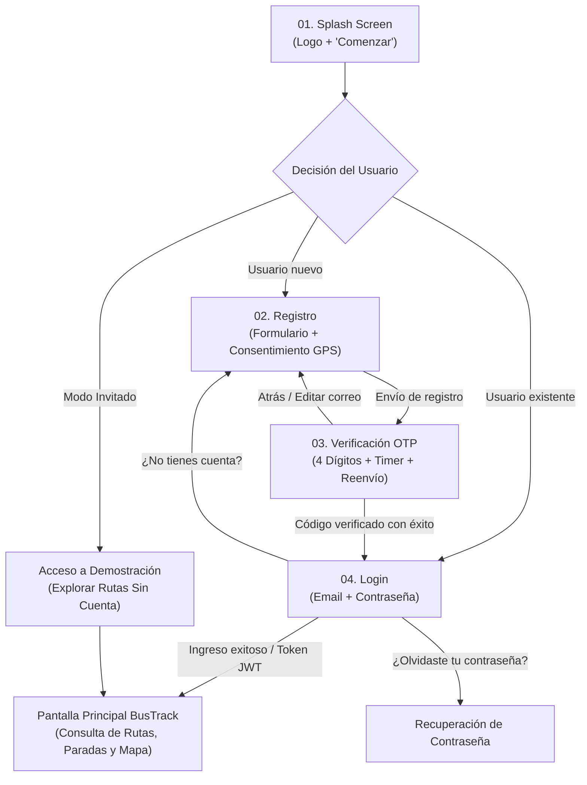

# BusTrack Mobile — Especificación UI/UX de Primeras Pantallas

> **Documento de Diseño UI/UX y Sistema Visual**  
> **Tecnología Objetivo:** Flutter & Dart  
> **Stack de Referencia:** Kotlin + Jetpack Compose  
> **Versión:** 1.0.0 (2026-11-05)  

---

## 1. Identidad Visual y Design Tokens

### 1.1 Paleta Cromática

| Token Semántico | Código HEX | Rol y Aplicación | Contraste sobre Blanco |
|---|---|---|---|
| **Primary** | `#CF1818` | Rojo BusTrack: Botones principales (CTA), bordes de focus activo, acentos de marca, logos y elementos clave. | **4.85:1** (WCAG AA texto regular, AAA componentes) |
| **Primary Dark** | `#9B1010` | Estados *pressed/hover* de botones principales y gradientes de branding. | **7.1:1** (WCAG AAA) |
| **Secondary** | `#906D6D` | Tonos complementarios: subtítulos, etiquetas secundarias, iconos pasivos y textos descriptivos. | **4.52:1** (WCAG AA) |
| **Tertiary / Soft** | `#FFD0C5` | Fondos suaves de tarjetas destacadas, badges de paso y áreas de advertencia/consentimiento amigable. | Fondo decorativo / bordes suaves |
| **Neutral Text** | `#333333` | Títulos principales, textos de campos de entrada, etiquetas de formulario y valores activos. | **12.6:1** (WCAG AAA) |
| **Surface White** | `#FFFFFF` | Fondo principal de pantallas, tarjetas elevadas y contenedores de formulario. | Base lumínica |
| **Input Background**| `#F8FAFC` | Fondo de campos de entrada (Slate 50) para garantizar percepción de área interactuable. | Fondo neutro |
| **Input Border** | `#E2E8F0` | Borde pasivo de inputs (Slate 200). | Delimitador visual |
| **Success Alert** | `#059669` | Indicador de servicio en vivo y confirmación de validación. | **4.6:1** |

### 1.2 Tipografía

- **Familia:** `Plus Jakarta Sans` (Google Fonts).
- **Escala Tipográfica:**
  - **Display / Brand:** 28sp / Bold (700) – Logo y splash screen.
  - **Title Large:** 24sp / ExtraBold (800) – Títulos de pantalla (`Crear Cuenta`, `Bienvenido`, `Verifica tu correo`).
  - **Body Medium:** 14sp / Medium (500) & Regular (400) – Mensajes explicativos y etiquetas de formulario.
  - **Body Small:** 12sp / Regular (400) & SemiBold (600) – Placeholders, microcopy legal y enlaces secundarios.
  - **Caption / Badge:** 11sp / ExtraBold (800) – Indicadores de paso (`PASO 3 DE 3`), tags de servicio.
  - **Monospace OTP:** `JetBrains Mono` o `Plus Jakarta Sans Mono` 24sp / Bold (700) – Códigos de verificación numérica.

### 1.3 Radios y Elevaciones

- **Botones y Contenedores Principales:** `BorderRadius.circular(16.0)`.
- **Inputs de Formulario:** `BorderRadius.circular(12.0)`.
- **Casillas OTP:** `BorderRadius.circular(16.0)` con borde de `2.0dp`.
- **Badges y Chips:** `BorderRadius.circular(999.0)`.
- **Sombras:** Elevación sutil `BoxShadow(color: Color(0x33CF1818), blurRadius: 16, offset: Offset(0, 6))`.

---

## 2. Flujo de Navegación del Usuario

---

## 3. Especificación Detallada por Pantalla

### Pantalla 01 – Splash Screen
- **Fondo:** `#FFFFFF` limpio.
- **Logotipo oficial:** Isotipo de BusTrack centrado con autobús vectorizado y acento `#CF1818`.
- **Nombre:** «Bus**Track**» con subtítulo «Movilidad Inteligente y Rutas Metropolitanas».
- **Botón principal:** Rojo `#CF1818`, esquinas redondeadas de 16dp, texto «Comenzar» con icono de avance.

### Pantalla 02 – Registro
- **Isotipo compacto:** BusTrack en cabecera.
- **Título y subtítulo:** «Crear Cuenta» / «Únete para rastrear autobuses y planificar tus rutas en tiempo real».
- **Campos:** Nombre completo, edad, selector de sexo (Masculino, Femenino, Otro, Prefiero no decir), correo electrónico y contraseña con botón para alternar visibilidad.
- **Consentimiento de alertas GPS:** Explicación transparente de uso de ubicación exclusivo para paradas favoritas y sin rastreo continuo (acorde a la constitución de BusTrack).
- **Acción principal:** Botón «Registrarse».
- **Acceso alternativo:** Enlace a Iniciar Sesión y botón dedicado «Explorar Demostración (Sin Registro)».

### Pantalla 03 – Verificación de Código (OTP)
- **Cabecera:** Botón para regresar e indicador «PASO 3 DE 3».
- **Título y destino:** «Verifica tu correo» con correo parcialmente oculto (ej. `u***r@ejemplo.com`) y botón de edición.
- **Casillas OTP:** 4 cajas individuales con enfoque automático y validación.
- **Temporizador:** Cuenta regresiva regresiva en vivo y enlace «Reenviar código».
- **Acción principal:** Botón «Verificar».
- **Microcopy:** «Cifrado y validación segura de identidad».

### Pantalla 04 – Login
- **Cabecera:** Logotipo de BusTrack, título «Bienvenido» y mensaje de bienvenida.
- **Campos:** Correo electrónico, contraseña con visibilidad toggle y enlace «¿Olvidaste tu contraseña?».
- **Acción principal:** Botón «Ingresar» con prevención de doble clic y spinner de carga.
- **Tarjeta informativa:** Tarjeta con fondo `#FFD0C5`, badge «EN SERVICIO» y datos de transporte metropolitano en vivo.
- **Pie:** Enlace «¿No tienes cuenta? Regístrate aquí» y acceso a demostración.

---

## 4. Consideraciones para Flutter & Dart
- Componentes 100% mapeables a widgets nativos de Flutter (`ElevatedButton`, `TextFormField`, `DropdownButtonFormField`, etc.).
- Soporte para desbordamiento de teclado virtual mediante `SingleChildScrollView`.
- Tokens de tema preparados para `ThemeData`.

