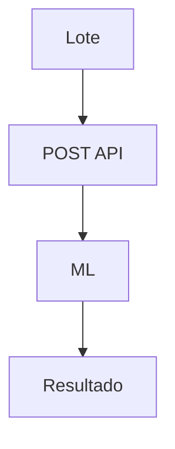
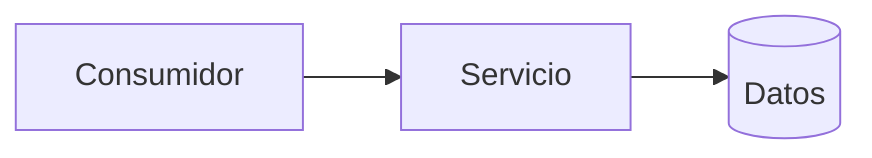
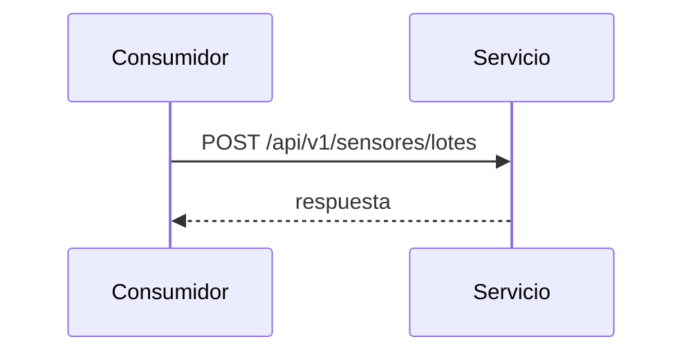

# Diagramas — 25-endpoint-lotes-de-acelerometro — Consumo del endpoint de lotes de acelerómetro

> Spec: `spec.md` · Plan: `plan.md`.

## 1. Flujo del endpoint

## 2. Componentes

## 3. Secuencia

## 4. Notas

Diagramas de proceso; no representan recursos desplegados.
