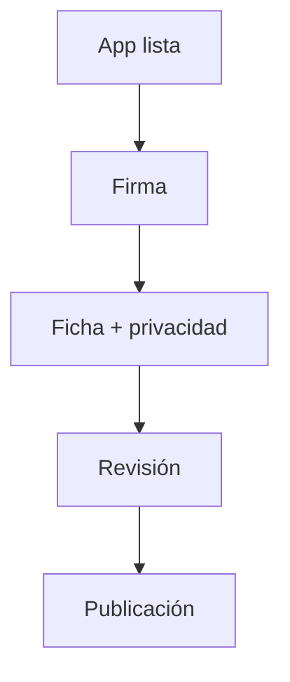
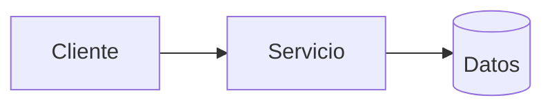
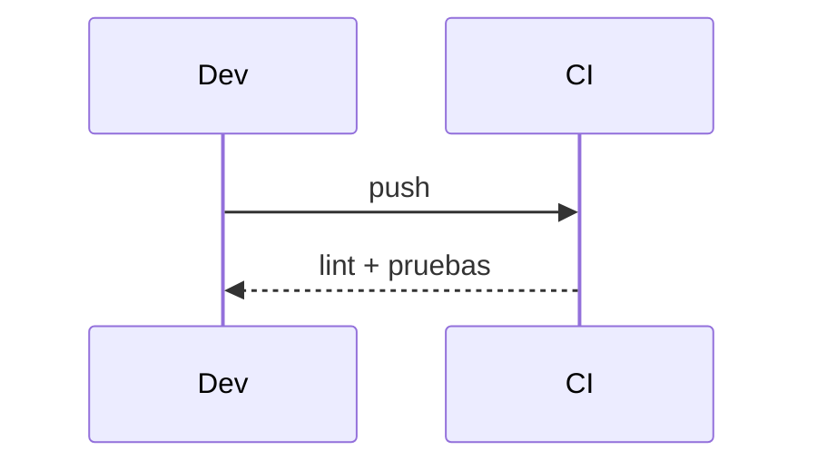

# Diagramas — 16-publicacion-en-google-play — Publicación en Google Play

> Spec: `spec.md` · Plan: `plan.md`.

## 1. Flujo funcional

## 2. Componentes

## 3. Secuencia

## 4. Notas

No hay publicación en Google Play.
